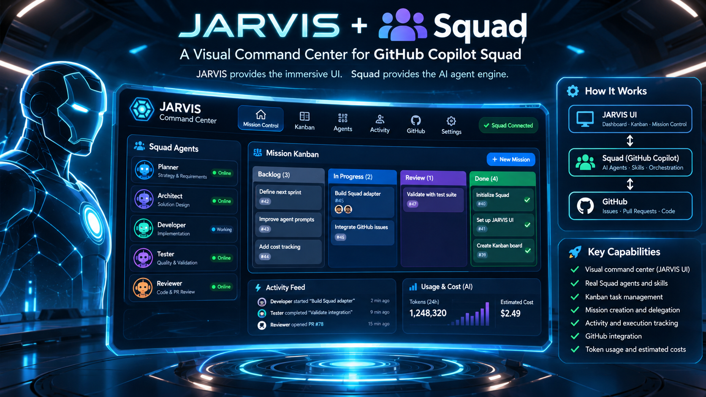

# Jarvis Squad Starter

A starter repo that pairs a patched, **read-only, offline** copy of the Jarvis 3D vault graph
(`vendor/jarvis`, AGPL-3.0-only, see `LICENSE` and `MODIFICATIONS`) with a small demo vault
(`demo-vault`) and a status-record format (`docs/status/README.md`). Once you create a
[Squad](https://github.com/github/squad) team in this repo, Jarvis can show its roster and a
Kanban of the team's *recorded* status.



*Concept illustration of the intended Jarvis + Squad command centre. It is not a screenshot: it shows features that are not built yet (live Online/Working status, live usage and cost panels, GitHub and Activity tabs). The working demo is read-only and shows recorded status only; see Limitations.*

## Prerequisites
- Git
- Node.js 22.5 or newer
- GitHub CLI (`gh`)
- GitHub Copilot CLI (`copilot`)

## Quick start
Five steps: clone, install, start Squad, create your team by prompting, launch Jarvis.

### 1. Clone the repo
```powershell
git clone https://github.com/solidplussol/jarvis-squad-starter.git
cd jarvis-squad-starter
```

### 2. Install
Run from the repo root:
```powershell
cd vendor\jarvis
npm ci --ignore-scripts
cd ..\..
npm install -g @bradygaster/squad-cli
gh auth login
```

### 3. Start Squad
From the repo root:
```powershell
copilot --agent squad --yolo
```
(`squad init` is only needed in a repo that has no `.squad\` folder yet; this starter already has one.)

### 4. Create your team by prompting
Type these prompts into the Squad session, in order:

| # | Prompt | What happens |
|---|--------|--------------|
| 1 | `Create an Avengers team with 4 people to build a simple React site` | Squad proposes a roster (plus built-ins Scribe, Ralph, Rai, Fact Checker) and asks you to confirm. Nothing is written yet. |
| 2 | `Yes, hire this team` | Squad writes the team to `.squad\team.md`, with charters and histories under `.squad\agents\`. |
| 3 | `Team, follow docs\status\README.md and write a status record to docs\status\<id>.md as you work` | Specialists record status so Jarvis can show it. |
| 4 | `Stark, plan a simple React site` or `Team, build a simple React site` | The team starts working. |

Change the team later with `Add a designer` or `Remove Banner`. Swap the universe or the roles as you
like (any theme, or role names such as **Architect, Knowledge, Integration, Security,
Verification**); Jarvis shows whatever roster is in `.squad\team.md`. Say `squad commands` to see
everything Squad can do.

### 5. Launch Jarvis
In the Squad session:
```
Launch Jarvis
```
Say `Stop Jarvis` to stop it. (This uses the `launch-jarvis` skill in `.github\skills\launch-jarvis`.)
Open the UI URL it prints. Refresh the browser after the team changes; no restart is needed.

Prefer to run it yourself?
```powershell
powershell -File scripts\start-jarvis.ps1
```
The script uses the first free port pair (starting at API 3102 / UI 5273, then +10 each) and
prints the URLs and PIDs; use the printed UI URL. Logs go to `.local\run\`.
Stop it with `Stop-Process -Id <pid>` using the PIDs the script prints.

Note: the port auto-selection in `scripts\start-jarvis.ps1` has not been run in testing. The
manual commands below were verified earlier on alternate ports (3112/5283).

## Squad documentation and CLI
This README only covers what you need for this starter. For all Squad commands, configuration,
team management, ceremonies and the CLI reference, see the public GitHub Squad project:
- Docs: https://github.github.io/squad/
- Repo: https://github.com/github/squad

### Run Jarvis manually (custom ports)
The ports below are examples; pick any free ports. Use two terminals.

Terminal 1 (from the repo root):
```powershell
cd vendor\jarvis
$env:JARVIS_PROJECT_MODE='1'
$env:JARVIS_PROJECT_VAULT=(Resolve-Path ..\..\demo-vault).Path
$env:JARVIS_PROJECT_API_PORT='3112'
$env:JARVIS_PROJECT_UI_PORT='5283'
node node_modules\tsx\dist\cli.mjs server/index.ts
```

Terminal 2 (from the repo root): set the same four variables, then:
```powershell
cd vendor\jarvis
npx vite
```

Open http://127.0.0.1:5283/. Quick check: http://127.0.0.1:3112/api/agents.

**Warning:** never run `vite` or `tsx` without those variables, or Jarvis reads `~\.jarvis-config.yaml`.

Details of the isolation mode: `docs\integrations\jarvis-project-isolation.md`.

## How the roster works
Jarvis shows whatever squad `.squad\team.md` lists (Members table). Status files are expected at
`docs\status\<id>.md` (lowercase slug of the member name), following `docs\status\README.md`.
Members without a status file show Configured; an empty or unparseable roster shows a reason.
The roster is re-read on each request, so after Squad changes the team a browser refresh is
enough (no restart). A card stays Configured until `docs\status\<id>.md` exists with a matching
Agent field. The built-in agents (scribe, ralph, rai, fact-checker) show only if listed in the Members table.

## Optional usage panel
Optional and OFF by default: a read-only "USAGE" panel in the Jarvis Mission view showing recorded token usage from the local Copilot session store. It is local-only on purpose: Jarvis stays read-only, holds no credentials or tokens, makes no outbound calls and reads two fixed allow-listed files (the opt-in flag and the summary) written by a user-run script. No GitHub billing/spend data is included. Turn on with `.local\usage-panel.json` containing `{"enabled": true}` and run `node scripts\usage-summary.mjs` (Node 24 recommended). Details, variables, extension rules and turn-off steps: `docs\integrations\jarvis-usage-panel.md`.

## Limitations
- The roster comes from `.squad\team.md`; the `docs/status/<id>.md` layout is fixed in the Jarvis code.
- The vault path must be set (`JARVIS_PROJECT_VAULT`) and must be exactly this repo's `demo-vault`;
  the start script sets it. Do not run `vite`, `vitest` or `tsx` in `vendor\jarvis` without the
  `JARVIS_PROJECT_*` variables, or Jarvis falls back to upstream behaviour and reads `~\.jarvis-config.yaml`.
- No live status: the panels show only what agents last recorded, never current execution.
- Read-only: Jarvis cannot edit notes or config, and mutation requests return 403.
- Not sandboxed, not browser-verified (see the isolation doc).

## License and credits

This sample is licensed under AGPL-3.0 (see [LICENSE](./LICENSE)). Attribution, third-party notices and the AGPL network-use note are in [NOTICE.md](./NOTICE.md).

Original repositories:
- Jarvis: [Prompt-Surfer/obsidian-jarvis-ui](https://github.com/Prompt-Surfer/obsidian-jarvis-ui) (vendored, modified; see `vendor\jarvis\MODIFICATIONS`)
- Squad: [github/squad](https://github.com/github/squad) (separate tool, not bundled; MIT per
  GitHub's licence metadata, see the repo's LICENSE for authoritative terms). Created by Brady
  Gaster ([bradygaster](https://github.com/bradygaster)), original author; earlier hosted at
  [bradygaster/squad](https://github.com/bradygaster/squad).
